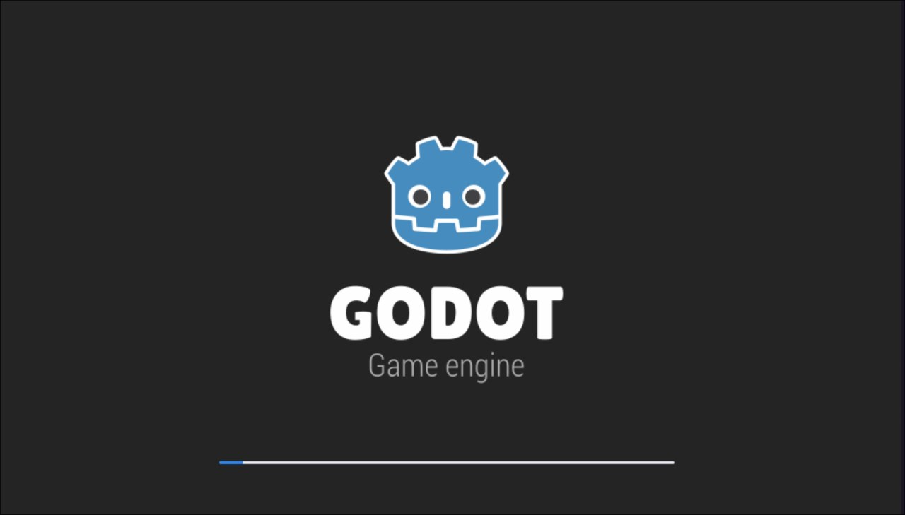

# Burmalda

**CTFCup 2026 · misc**
**Флаг:** `ctfcup{Сначала_ДЭП_Потом_Додэп_Потом_ласт_Дэп_потом_Ультра_Ласт_Дэп_и_всё_будет_чётко!}`
**Описание**: Я дэпнул! Я иду до конца!

## 1. Заходим на инстанс

На главной странице видим загрузку Godot



Это игровой движок. Читаем исходный код страницы и видим Godot config с такими параметрами:

```js
"fileSizes":{"Burmalda.pck":43760,"Burmalda.wasm":52126319}
```

## 2. Скачиваем файлы

- `Burmalda.pck` (43 КБ) — ресурсы и скомпилированные скрипты
- `Burmalda.wasm` (52 МБ) — сама игра

Через `strings` флага не видно, значит надо реверсить

## 3. Реверс

Изучив как работает реверс Godot ставим GDRE Tools и декомпилим

```
gdre_tools.x86_64 --recover=Burmalda.pck --output=out
```

В папке видим `main.gd` и `wheel.gd`. В `main.gd` основной алгоритм

```gdscript
func _decode_flag() -> String:
 var state: int = (_SA ^ _SB) & 4294967295
 var out: = PackedByteArray()
 out.resize(_EF.size())
 for i in range(_EF.size()):
  state = (_LC * state + _LA) & 4294967295
  var kb: int = (state >> 13) & 255
  out[i] = ((_EF[i] ^ kb) - i) & 255
 return out.get_string_from_utf8()
```

Флаг показывается при достижении баланса `13371337`, но в памяти клиента он и цель хранятся зашифрованным с случайным `key`. Они генерируются в рантайме, чисто в теории, их можно получить, но не нужно, ведь для декодирования флага key не нужен

## 4. Декодирование

Повторяем `_decode_flag()` на Python с теми же константами

```python
EF = [178, 199, 143, 9, ...]
cur = (3405691582 ^ 322376503) & 0xFFFFFFFF
res = bytearray()
for i in range(len(EF)):
    cur = (1664525 * cur + 1013904223) & 0xFFFFFFFF
    res.append(((EF[i] ^ ((cur >> 13) & 255)) - i) & 255)
print(res.decode('utf-8'))
```

Вывод:

```
ctfcup{Сначала_ДЭП_Потом_Додэп_Потом_ласт_Дэп_потом_Ультра_Ласт_Дэп_и_всё_будет_чётко!}
```

## Итог

Простенькая задача на реверс алгоритма, зато с забавным названием
