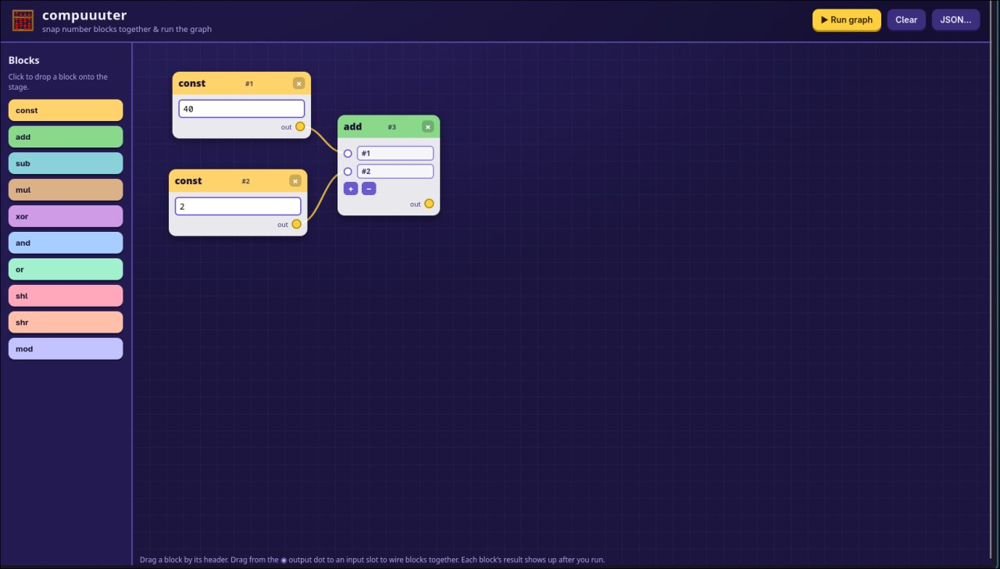

# compuuuter

**CTFCup 2026 · web · beginner**
**Флаг:** `ctfcup{9cd591ac67dd2dc2b6f439b2c88617be_54e1814b470028ca}`
**Описание:** I build a new scratch competitor

## 1. Осматриваемся

Сервис `baby-compuuuter` написан на питоне, - граф-вычислитель. Пользователь загружает граф узлов, патчит его, запускает `/compute` и читает результаты по каждому узлу



В коде есть скрытый опкод `T_FLAG = 1337`, результатом которого является флаг в виде little-endian числа. Обычным пользователям его запрещают функцией `guard()`

## 2. Ищем уязвимость

Смотрим в `app.py` функцию `compute()`:

```python
def compute(nodes):
    # TIME OF CHECK: the flag opcode must be absent.
    guard(nodes)
    ...
    def evaluate(nid, stack):
        ...
        # TIME OF USE: node fields are read here, live.
        t = node["type"]
        if t == T_FLAG:
            val = FLAG_INT
```

Проверка `guard()` выполняется один раз в начале `compute()`. Значение `type` читается заново во время `evaluate()`, и между этими моментами граф можно менять

Второй эндпоинт - `PATCH /api/graph/<gid>` вызывает `parse_node()` и не вызывает `guard()`. Он напрямую переписывает `type` узла в уже сохранённом графе. Видим race condition

## 3. Эксплуатация

Просим клод написать скрипт, который:

1. Загрузит граф из ~40 000 узлов типа `CONST` (`type=1`), а последним будет целевой узел `TARGET = 999999` тоже типа `CONST`. Большой граф даёт `compute` десятки миллисекунд для нашей гонки
2. В отдельном потоке запустит `POST /api/graph/<gid>/compute`
3. Через `delta` миллисекунд (перебор от 10 до 590 мс с шагом 10) сделает `PATCH` узла `TARGET`, поставив `type=1337`
4. Дождется, пока `evaluate()` дойдёт до `TARGET`. К этому моменту `guard()` уже будет пройден, и `t == T_FLAG` даёт `FLAG_INT`.
5. Вернет `type=1` и повторит, если окно промахнулось. Результат `n > 255` - тогда это не константа, а флаг
6. Декодирует: `n.to_bytes(nb, "little").decode()`

Эксплойт лежит в этом же репо

## Итог

Простая гонка: проверка `guard()` и использование опкода разнесены во времени, а `PATCH` в обход проверки меняет тип узла прямо во время вычисления


Больше разборов и заметок — в Telegram: [rivest | CTF & ИБ](https://t.me/rivest_sec)
